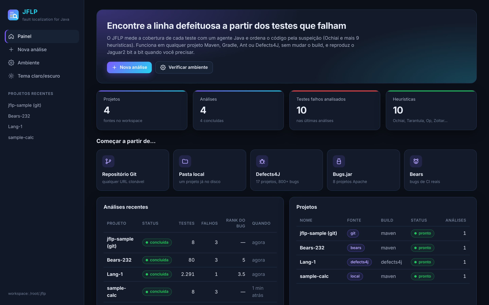
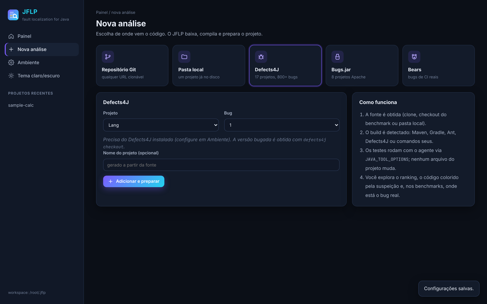
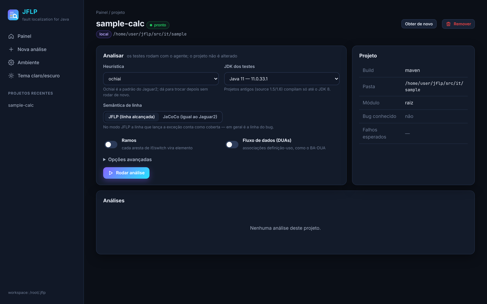
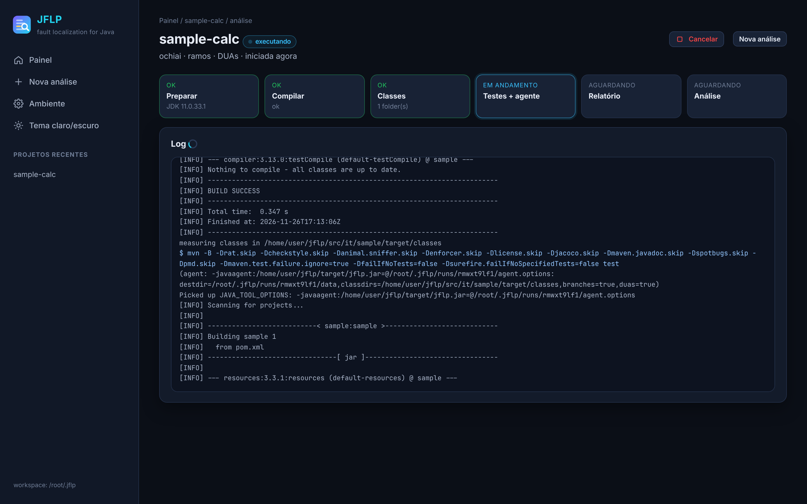
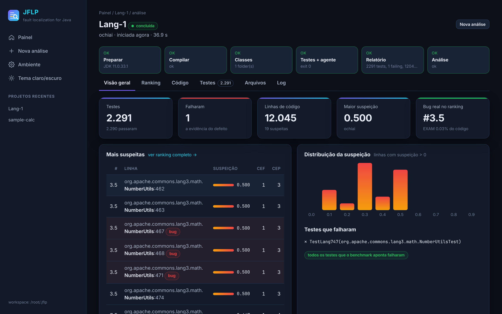
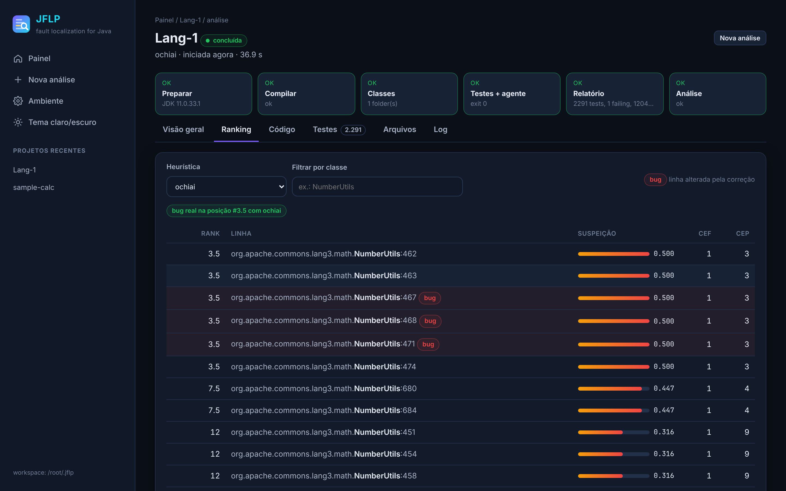
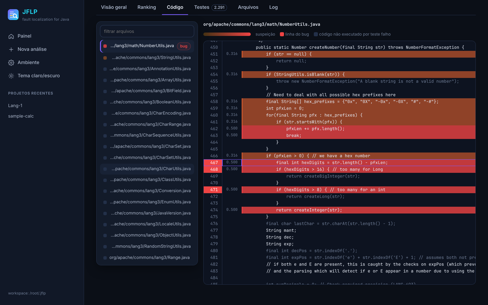
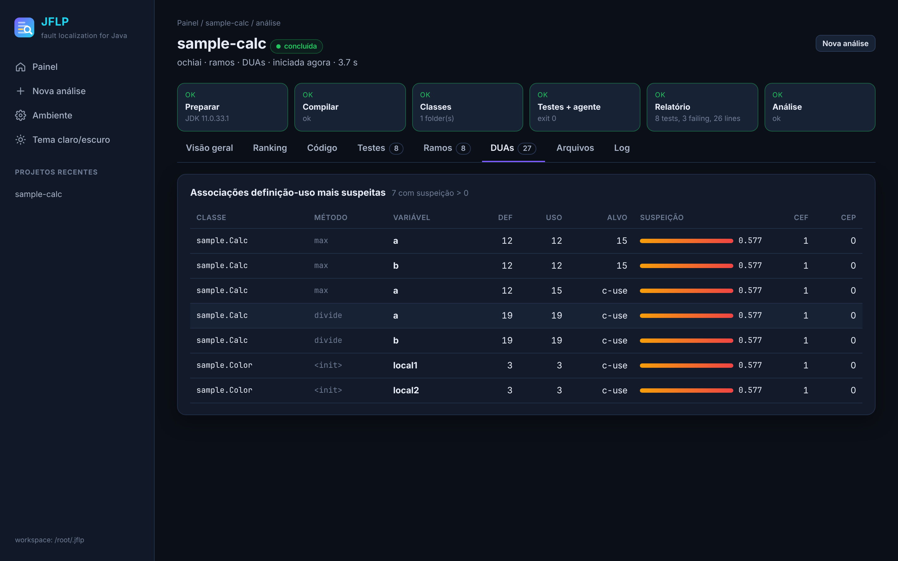
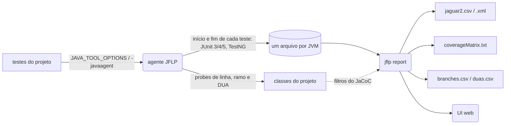

<p align="center">
  
</p>

<h1 align="center">JFLP</h1>

<p align="center">
  <b>Localização de defeitos por espectro (SBFL) para Java.</b><br>
  Rode os testes, veja o código colorido pela suspeição e chegue à linha do bug.
</p>

<p align="center">
  
  
  
  
</p>

<p align="center">
  
</p>

O JFLP mede **a cobertura de cada teste** com um agente Java e ordena o código pela
probabilidade de conter o defeito, usando os testes que falham como evidência: as
linhas executadas pelos testes que falham, e pouco pelos que passam, sobem no
ranking. Faz o que o [Jaguar2](https://github.com/saeg/jaguar2) e o seu
[fork com matriz de cobertura](https://github.com/c3nt4ur1/jaguar2) fazem, gerando os
mesmos arquivos, **sem mexer no build, de Java 5 em diante e de 4 a 127 vezes mais
rápido**. Vem com uma interface web para trabalhar com qualquer repositório ou
benchmark de bugs.

## Por que o JFLP

| | Jaguar2 (fork) | JFLP |
|---|---|---|
| Integração | dependências e listener no `pom.xml` | `-javaagent`, nenhum arquivo do projeto muda |
| Frameworks | JUnit 4 | JUnit 3, 4, 5 (qualquer engine da JUnit Platform) e TestNG 6/7 |
| Launchers | Surefire | Surefire, Ant, Defects4J, `JUnitCore`, qualquer JVM |
| Desempenho | reanalisa todas as classes a cada teste | um probe por linha; o relatório analisa cada classe uma vez |
| Linha que lança a exceção | não coberta (semântica do JaCoCo) | coberta: em geral é a linha do bug |
| Elementos | linhas | linhas, ramos e associações definição-uso (DUAs) |
| Compatibilidade de saída | — | `jaguar2.csv`, `jaguar2.xml` e `coverageMatrix.txt` byte a byte com `lines=jacoco` |
| Interface | — | web local: fontes, execução ao vivo, ranking, código anotado |

## A interface

`java -jar jflp.jar ui` abre uma aplicação web local (só em `127.0.0.1`). Você
escolhe a fonte, o JFLP obtém o código, compila, roda os testes com o agente e mostra
o resultado.

**1. Escolha de onde vem o código**: repositório Git, pasta local, Defects4J,
Bugs.jar ou Bears. Nos benchmarks, a lista de projetos e bugs vem do próprio
benchmark.

<p align="center"></p>

**2. Configure e rode**: heurística, JDK, semântica de linha, ramos e DUAs. As etapas
e o log aparecem ao vivo.

<p align="center">
  
  
</p>

**3. Encontre o bug**: visão geral com a distribuição da suspeição e, quando o
benchmark conhece a correção, **em que posição do ranking o bug real ficou** (aqui,
o Defects4J Lang-1).

<p align="center"></p>

**4. Ranking e código anotado**: troque de heurística sem rodar de novo, filtre por
classe e clique numa linha para abrir o código colorido pela suspeição, com as
linhas que a correção alterou marcadas.

<p align="center">
  
  
</p>

**5. Ramos e fluxo de dados**: com `branches` e `duas`, cada aresta de desvio e cada
associação definição-uso também vira elemento do espectro.

<p align="center"></p>

## Começo rápido

Requisitos: um JDK 8 para compilar (é o último `javac` que gera bytecode Java 5) e
Maven. Para usar: qualquer JVM 5+ para o agente e 8+ para a interface.

```bash
git clone https://github.com/alexzjss/jflp && cd jflp
JAVA_HOME=/caminho/do/jdk8 mvn package        # gera target/jflp.jar
```

### Pela interface

```bash
java -jar target/jflp.jar ui                  # abre http://127.0.0.1:7070
```

Opções: `--port N`, `--workspace DIR` (padrão `~/.jflp`) e `--no-browser`. Para o
Defects4J, informe a pasta dele em **Ambiente**.

### Pela linha de comando

```bash
cd meu-projeto
JAVA_TOOL_OPTIONS="-javaagent:/caminho/jflp.jar" mvn clean test
java -jar /caminho/jflp.jar report            # grava em target/
```

Outras formas de anexar o agente: `mvn test -DargLine=-javaagent:...` ou
`-javaagent` direto na linha do `java`. O JDK 8 e anteriores **ignoram em silêncio** um
`JAVA_TOOL_OPTIONS` com mais de 1.024 caracteres. Com caminhos longos, ponha as opções
num arquivo: `-javaagent:jflp.jar=@opcoes.txt`.

| opção do agente | padrão | efeito |
|---|---|---|
| `destdir` | `target/jflp` | onde cada JVM grava sua cobertura |
| `classdirs` | `target/classes` | pastas das classes medidas (`:` no Linux, `;` no Windows) |
| `lines` | `entry` | `jacoco` instrumenta com o JaCoCo 0.8.7 e reproduz o Jaguar2 bit a bit |
| `branches` | `false` | mede cada aresta de desvio e de `switch` |
| `duas` | `false` | mede as associações definição-uso de variáveis locais |

`report` aceita `--data`, `--classes`, `--out`, `--heuristic` (ochiai, tarantula,
jaccard, zoltar, op, minus, mccon, drt, kulczynski2, wong3), `--all-lines`,
`--no-matrix` e `--strict`.

## O que sai

| arquivo | conteúdo |
|---|---|
| `jaguar2.csv`, `jaguar2.xml` | no formato dos exportadores do Jaguar2 |
| `coverageMatrix.txt` | a matriz do fork: um teste por linha, `0`/`1` por linha de código, `+`/`-` |
| `coverageMatrix.columns.csv`, `.tests.csv` | a classe e linha de cada coluna e o teste de cada linha (o fork não grava) |
| `spectra.csv` | todas as linhas de código, suspeição 0 inclusa (`--all-lines`) |
| `branches.csv`, `branchMatrix.txt` | espectro por aresta de desvio (`branches=true`) |
| `duas.csv`, `duaMatrix.txt` | espectro por associação definição-uso (`duas=true`) |
| `jflp-summary.txt` | contagens e todos os avisos |

## Resultados

Comparação com o Jaguar2 fork em 29 bugs de Defects4J, Bugs.jar e Bears, com o mesmo
runner, a mesma lista de testes e o mesmo JDK
([tabelas completas](docs/BENCHMARKS.md)):

| bug | sem ferramenta | Jaguar2 | JFLP | bug real no ranking (Jaguar2 → JFLP) |
|---|---|---|---|---|
| Defects4J Chart-1 | 2,3 s | 354,5 s | **2,8 s** | 35 → 35 |
| Defects4J Time-1 | 1,7 s | 226,8 s | **2,4 s** | 3,5 → 3,5 |
| Defects4J Lang-1 | 29,8 s | 137,9 s | **31,2 s** | 60 → **3,5** |
| Bugs.jar MATH-1005 | 59,7 s | 1.050 s | **67 s** | 8,5 → 9,5 |
| Bears-202 (classgraph) | 5,6 s | 13,2 s | **7,6 s** | 4.824,5 → **4** |

- **Mesmas linhas, mesmo layout.** Que linhas contam como código é decidido pelos
  próprios filtros do JaCoCo 0.8.7, a versão do fork. O resultado é idêntico ao
  `Analyzer` do JaCoCo no `rt.jar` inteiro do JDK 8 (19.907 classes) e em módulos do
  JDK 21.
- **Bit a bit quando preciso.** Com `lines=jacoco`, o CSV e a matriz saem idênticos aos
  do fork no jsoup, em Defects4J Chart-1, Cli-1 e Codec-1 e em 6 bugs do Bears.
- **Mais assertivo por padrão.** A linha que lança a exceção conta como coberta. No
  Bears-202, o teste falha justamente por uma exceção na linha do bug.
- **Sem efeitos colaterais.** O Jaguar2 quebra testes que passam sem ferramenta: no
  Lang, o ASM que ele traz conflita com o do projeto; no feign, o campo `$jacocoData`
  aparece na serialização por reflexão. O JFLP realoca suas dependências e não acrescenta
  campos às classes.

## Como funciona



- **Agente** (bytecode Java 5, ASM e JaCoCo realocados no jar): instrumenta só as
  classes das pastas medidas. A cobertura é zerada no início de cada teste e gravada no
  fim, e cada teste é gravado assim que termina, então um JVM morto não perde o que já
  rodou. O runtime fica acessível por campos injetados numa classe do JDK, de modo que
  funciona também em class loaders isolados (Ant, OSGi).
- **Testes**: o agente identifica os testes interceptando o próprio framework
  (`RunNotifier`, `TestResult`, `EngineExecutionListener`, `ITestListener`), sem
  depender de listener no build.
- **Relatório**: junta os arquivos de todas as JVMs (`forkCount > 1`), mapeia probes
  para linhas uma única vez por classe e calcula as 10 heurísticas em `double`.
- **UI** (Java 8, embutida no mesmo jar): servidor HTTP local, SPA sem dependências,
  workspace persistente em `~/.jflp`. Só escuta em `127.0.0.1`, confere o `Host` e exige
  um token de sessão nas ações.

## Compatibilidade e limites

- Agente: qualquer JVM de Java 5 em diante. Testado com JDK 8, 11 e 21. Não havia
  JVM 5/6 disponível para testar a execução de fato; o bytecode é Java 5, verificado
  pelo animal-sniffer.
- Builds: Maven (inclusive multi-módulo), Ant, Defects4J e `JUnitCore`. O Gradle tem
  suporte básico e ainda não foi testado em projetos reais.
- Métodos que os probes empurram além do limite de JIT do HotSpot (8.000 bytes) rodam
  interpretados. O agente avisa, e `-XX:-DontCompileHugeMethods` resolve. O JaCoCo tem o
  mesmo problema.
- DUAs: só variáveis locais, e métodos com mais de 1.024 associações ficam de fora,
  com aviso.
- Testes rodando em paralelo no mesmo JVM não podem ser separados; isso vira aviso, e
  não dado misturado.

## Desenvolvimento

```bash
JAVA_HOME=/caminho/do/jdk8 mvn package        # compila, testa e empacota
src/it/run-sample.sh /caminho/do/jdk          # exemplo JUnit 3/4 com o agente
FLOWS=local,git node src/it/ui/e2e.js         # teste ponta a ponta da UI (Playwright)
```

- **Testes unitários**: comparam o conjunto de linhas e o número de ramos com o
  JaCoCo, passam as classes instrumentadas pelo verificador da JVM e cobrem a
  semântica de linhas, ramos e DUAs. Use `-Djflp.corpus=a.jar:b.jar` para testar com
  outro corpus.
- **Teste da UI** (`src/it/ui/e2e.js`): dirige a interface com Playwright em quatro
  fluxos (pasta local, Defects4J com `D4J_HOME`, Bears e Git), confere os resultados e
  gera as capturas deste README.
- **Benchmarks** (`bench/`): harnesses para Defects4J, Bugs.jar e Bears, comparando
  com o Jaguar2. Veja [docs/BENCHMARKS.md](docs/BENCHMARKS.md).
- **Exemplos** em `src/it`: `sample` (JUnit 3/4), `sample-junit5` (Jupiter e vintage) e
  `sample-testng`.

## Licença

MIT. Veja [LICENSE](LICENSE). Componentes de terceiros embutidos no jar, realocados em
`jflp.internal`: ASM (BSD-3-Clause) e JaCoCo core 0.8.7 (EPL-2.0).
