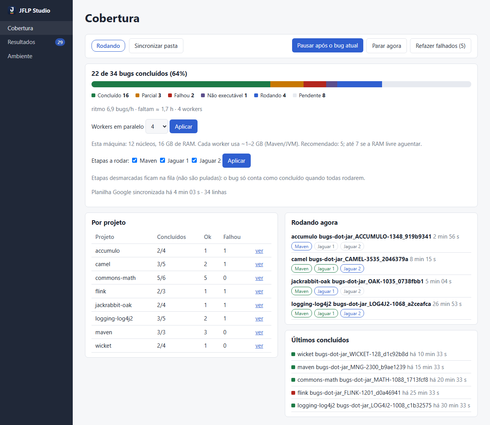
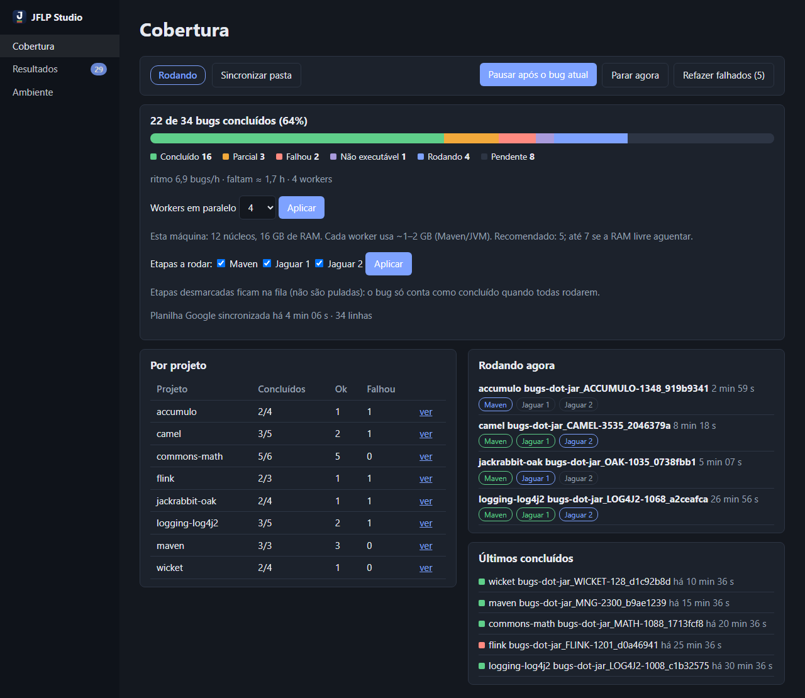
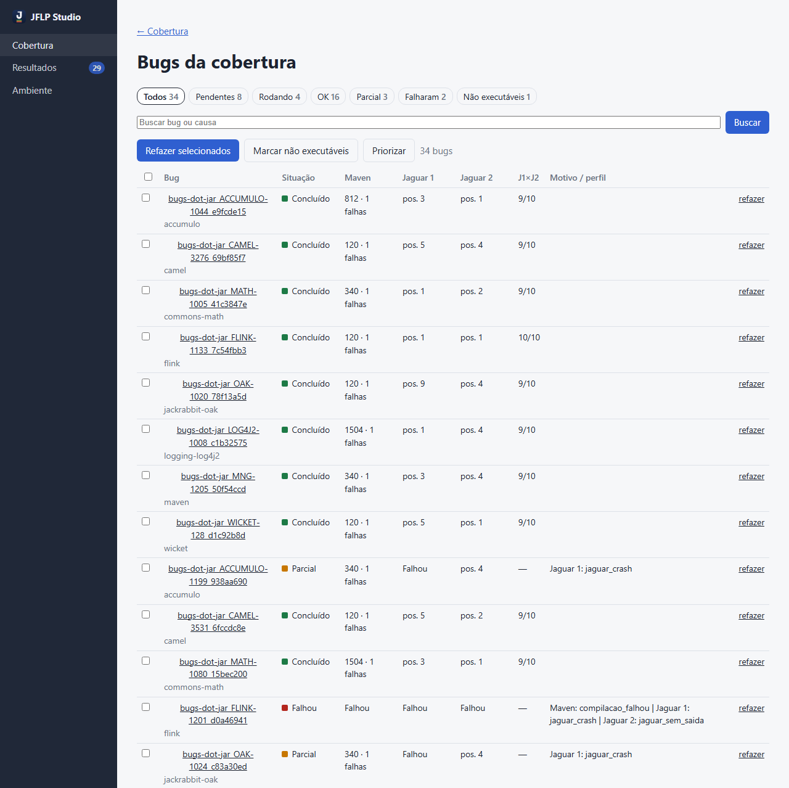
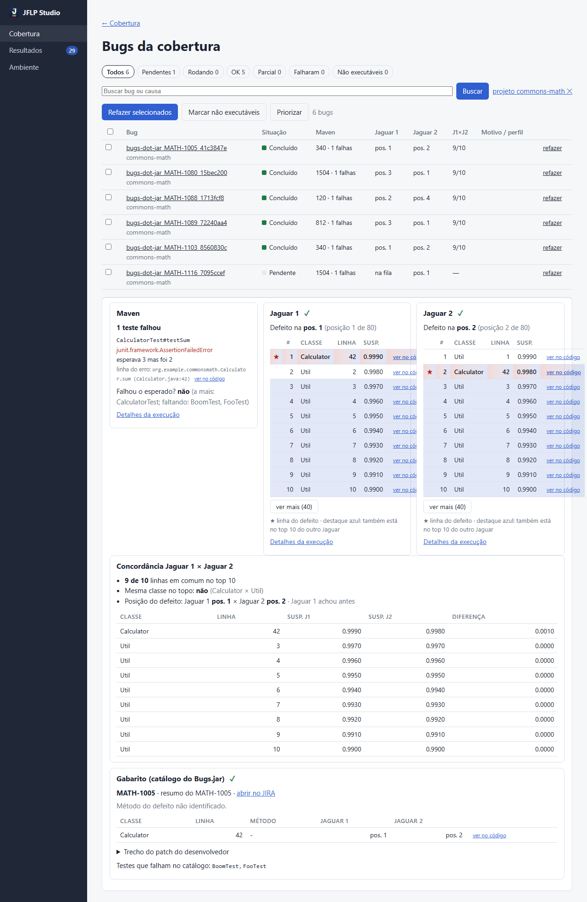
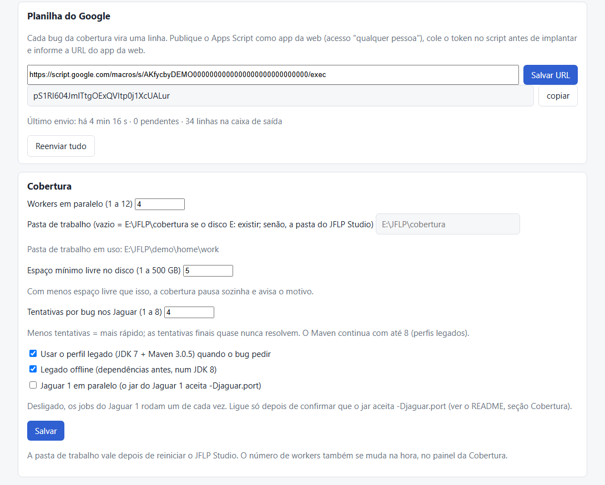

<p align="center"></p>

<h1 align="center">JFLP Studio</h1>

Ferramenta local (Windows e Arch Linux) para rodar **Maven puro**, **Jaguar 2** (principal) e **Jaguar 1** (compatibilidade) sobre versões defeituosas de projetos Java, guardar os **resultados brutos** de cada execução e compará-los. Serve para gerar, em escala, dados de cobertura de linhas (espectros) com o Jaguar 2 a partir de benchmarks como Defects4J e Bugs.jar.

O uso principal hoje é a **cobertura do bugs-dot-jar** (seção 8): Maven, Jaguar 1 e Jaguar 2 sobre todos os bugs da coleção, com vários workers em paralelo, retomável e com os resultados indo sozinhos para uma planilha do Google (seção 9). Para onde o projeto vai: [docs/ROADMAP.md](docs/ROADMAP.md). O que mudou em cada versão: [CHANGELOG.md](CHANGELOG.md).

O que ela faz:

- roda o Maven e o Jaguar 2 "limpos": o Jaguar 2 usa um POM gerado (`jaguar2-pom.xml`) ao lado do original, que nunca é alterado;
- aplica automaticamente as correções conhecidas para projetos legados (animal-sniffer, compiler, Surefire antigo, testes fora de `src/test/java`, ...);
- distingue **falha de teste** (é o bug, é dado) de **falha de infraestrutura** (build, JDK, plugin, Jaguar), diagnostica a segunda em português e tenta a busca automática de correções;
- grava cada execução numa pasta imutável (logs completos, saídas puras, ambiente exato, checkout);
- mostra, por bug, o que o Maven, o Jaguar 1 e o Jaguar 2 acusaram, com o veredito contra o defeito catalogado no Bugs.jar e a concordância entre os dois Jaguar;
- roda lotes numa fila com N workers em paralelo (a cobertura usa vários; um lote comum, por padrão, um só), retomável após fechar o programa;
- exporta um dataset (saídas puras do Jaguar 2 + `manifest.csv/json`) pronto para publicar, pela linha de comando.

A ferramenta **não calcula** fórmulas SBFL nem EXAM: o score de cada linha é o que o próprio Jaguar grava.

Licença: veja [LICENSE](LICENSE).

## Índice

1. [Instalação](#1-instalação)
2. [Primeira execução](#2-primeira-execução)
3. [Defects4J no Windows (WSL)](#3-defects4j-no-windows-wsl)
4. [Configurações (`config.toml`)](#4-configurações-configtoml)
5. [Como o Jaguar 2 é executado](#5-como-o-jaguar-2-é-executado)
6. [Status e diagnóstico](#6-status-e-diagnóstico)
7. [Busca automática e receitas](#7-busca-automática-e-receitas)
8. [Cobertura do bugs-dot-jar](#8-cobertura-do-bugs-dot-jar)
9. [Planilha do Google](#9-planilha-do-google)
10. [Layout da pasta de execução](#10-layout-da-pasta-de-execução)
11. [Layout do dataset exportado](#11-layout-do-dataset-exportado)
12. [Referência da linha de comando](#12-referência-da-linha-de-comando)
13. [Solução de problemas](#13-solução-de-problemas)
14. [Desenvolvimento](#14-desenvolvimento)

## 1. Instalação

Requisitos mínimos: **Python 3.11 ou mais novo** e **git**. JDK e Maven podem ser baixados pela própria ferramenta (tela Ambiente); eles ficam na pasta do JFLP e nada é alterado no sistema (PATH, registro, `~/.bashrc`). O Jaguar 2 vem do Maven Central como dependência do POM gerado.

Os lançadores criam um `.venv` ao lado do script na primeira execução (com o Python ≥ 3.11 encontrado) e rodam `pip install -e .[full]`; se o extra falhar, instalam sem ele. O extra `full` traz `zstandard` (checkout arquivado em `.tar.zst`, senão `.zip`) e `pywebview` (janela própria). Sem argumentos (inclusive com duplo clique no `jflp.cmd`), o lançador do Windows cria o atalho **JFLP Studio** na Área de Trabalho e no Menu Iniciar se ele ainda não existir e abre a janela do app sem console (`jflp ui --app`); para ver a saída no terminal, use `.\jflp.ps1 ui`. No Linux, sem argumentos, o `jflp.sh` executa `jflp ui`. Se uma instalação falhar pela metade ou as dependências mudarem (por exemplo, depois de um `git pull`), apague a pasta `.venv` e rode o lançador de novo para reinstalar tudo.

**Windows** (PowerShell ou cmd):

```powershell
git clone <url-do-repositorio> jflp
cd jflp
.\jflp.ps1            # 1ª vez: instala, cria o atalho e abre o app
.\jflp.ps1 ui         # interface com a saída no terminal
.\jflp.ps1 doctor     # qualquer comando da CLI
jflp.cmd selftest     # mesmo lançador, para o cmd ou duplo clique
```

O `jflp.ps1` procura `py -3` (e confere `sys.version_info >= 3.11`), senão `python`. Se o PowerShell bloquear scripts, use `jflp.cmd` (ele chama o PowerShell com `-ExecutionPolicy Bypass`).

**Arch Linux:**

```bash
sudo pacman -S python git
git clone <url-do-repositorio> jflp
cd jflp
./jflp.sh             # abre a interface (jflp ui)
./jflp.sh doctor
```

> O `jflp.sh` foi escrito junto com o resto, mas só teve a sintaxe conferida (`bash -n`); a execução em Arch ainda não foi verificada.

**Pasta do JFLP** (`tools/`, `m2/`, `work/`, `runs/`, `recipes/`, `datasets/`, `jflp.db`, `config.toml`):

- Windows: `%LOCALAPPDATA%\jflp`
- Linux: `~/.jflp`
- para mudar: variável de ambiente `JFLP_HOME`. No Windows prefira um caminho **curto** (ex.: `C:\jflp`) por causa do limite de 260 caracteres.

## 2. Primeira execução

```text
.\jflp.ps1 ui        # ou ./jflp.sh ui
```

O servidor sobe em `127.0.0.1` (porta livre, ou `--port`) e abre o navegador; `--no-browser` não abre, `--window` usa uma janela própria (pywebview). `--app` abre uma janela de app do Edge/Chrome/Chromium (sem barra de endereço) e encerra o servidor quando você a fecha; se o app já estiver aberto, só abre a janela dele. A barra lateral tem três telas: **Cobertura** (a página inicial), **Resultados** e **Ambiente**. Receitas, exportação do dataset e lotes comuns continuam na linha de comando (seção 12); a cobertura tem tela própria (seção 8).

**Assistente de primeiro uso** (`/bem-vindo`). Enquanto o perfil do Jaguar 2 não estiver completo, a página inicial abre o assistente. Ele mostra o que já existe (Git, perfis Jaguar 2, Maven puro e Jaguar 1, dependências do Jaguar 2 no `m2/`) e o botão **Preparar tudo** (ou **Só o essencial**). Antes de baixar, a tela lista o endereço, o tamanho e o destino de cada item. Depois baixa tudo em sequência, pula o que já existe e, se um item falhar, segue para os outros. "Pular por agora" dispensa o assistente, e ele continua acessível pela tela Ambiente.

**Rodar** (página inicial). Usar a ferramenta é um fluxo só, na mesma tela:

1. **Pasta.** Cole o caminho (ou clique em **Escolher pasta…**, onde o seletor de pastas estiver disponível) de uma destas opções: a pasta do repositório bugs-dot-jar (com vários projetos dentro), um projeto dela (um repositório só) ou um projeto Maven. As pastas usadas recentemente aparecem como botões logo abaixo. Ao abrir uma pasta de coleção do Bugs.jar, ela passa a ser a `bugsjar.root` (a tela avisa "Pasta salva como raiz do Bugs.jar").
2. **Projetos e bugs.** Numa coleção, cada projeto é uma seção recolhível com seus bugs; "Abrir todos os projetos" abre todos de uma vez. Cada bug aparece com o ID (ex.: `LANG-7`) e o **resumo do JIRA**, que chega logo depois de abrir o projeto (o resumo é lido do git, por isso vem à parte). Você pode buscar por ID ou resumo, marcar e desmarcar os bugs visíveis e filtrar pelo último resultado (nunca rodados, com falha ou OK). A seleção vale entre projetos, e o contador mostra "N bugs em M projetos". Um único envio cria um lote com todos. Os projetos precisam estar clonados: a tela não faz `fetch`, então rode `jflp fetch` antes quando for preciso (seção 12). Em projeto Maven, esta etapa vira a escolha do **Módulo** (ver abaixo).
3. **Ferramentas.** **Maven** e **Jaguar 2** vêm marcados; **Jaguar 1** vem desmarcado. Os testes são os **relevantes do catálogo** (padrão) ou **todos**.
4. **Opções** (recolhidas). **Busca automática de correções**, ligada por padrão.
5. **Rodar.** A página não muda de tela: o formulário recolhe numa linha ("12 bugs em 3 projetos · Maven, Jaguar 2") com o botão **Alterar**, e logo abaixo aparece a vista do lote. A URL vira `/rodar?lote=N`; recarregar a página mostra o mesmo lote.

**Vista do lote (resultado na mesma tela).** Uma linha por bug, com as colunas **Maven**, **Jaguar 1** (se marcado), **Jaguar 2** (se marcado) e **Gabarito**. Enquanto a execução anda, cada célula mostra o andamento ("rodando…") ou "na fila". Terminada a execução:

- **Maven**: "2 falhas" ou "nenhuma falha", ou o rótulo do status de erro;
- **Jaguar**: a posição do defeito no ranking, por exemplo "pos. 3" (a faixa de empate aparece no tooltip), ou o rótulo do erro;
- **Gabarito**: o veredito do bug, com as posições ao lado (por exemplo "✓ achou · J2 pos. 1 · J1 pos. 3").

Os vereditos por Jaguar seguem a posição esperada da melhor linha do defeito:

- **✓ achou**: posição até 10;
- **~ parcial**: posição até 50, ou uma classe do defeito entre as classes das 10 primeiras linhas;
- **✗ não achou**: o resto, inclusive defeito fora do ranking;
- **— sem dado**: sem gabarito, sem execução do Jaguar ou com erro.

No Gabarito aparece o melhor veredito entre os Jaguar do lote. Só com Maven: ✓ se as classes com falha batem com as do catálogo, ~ se há alguma em comum, ✗ se nenhuma, — sem catálogo.

O cabeçalho mostra a contagem por veredito (✓ 7 · ~ 2 · ✗ 1 · — 2), o botão **Baixar CSV** (uma linha por bug) e, enquanto houver execuções pendentes, **Cancelar lote**: as que ainda não começaram saem da fila, e a que está rodando é interrompida.

**Detalhe do bug.** Clicar na linha abre o detalhe embaixo dela:

- **Maven**: os testes que falharam (`Classe#método`), o tipo e a mensagem da exceção, a linha do erro (primeiro frame em código de produção, com link para o código) e "Falhou o esperado?", que compara as classes de teste com falha com as do catálogo.
- **Cada Jaguar**: as 10 linhas mais suspeitas (classe, linha, suspeição), com "ver mais" até 50. A linha do patch do desenvolvedor leva ★, e as linhas que também estão no top 10 do outro Jaguar ficam destacadas. Cada linha tem "ver no código". Quando a execução falhou, aparecem o status e o diagnóstico, com link para os detalhes da execução.
- **Concordância J1 × J2** (quando os dois rodaram): quantas linhas estão em comum no top 10, se a classe do topo é a mesma, a posição do defeito em cada Jaguar e qual achou antes, além de uma tabela das linhas em comum com a suspeição de cada um.
- **Gabarito do catálogo**: resumo e link do JIRA, o método que contém o defeito, as linhas do defeito com a posição em cada Jaguar, o trecho do `developer-patch.diff` (recolhível, com as linhas removidas e adicionadas destacadas) e os testes que falham no catálogo.

**Resultados.** Lista dos lotes, mais recentes primeiro, com data, ferramentas, número de bugs, contagem de vereditos e estado (rodando, terminado ou cancelado). "Abrir" reabre a mesma vista do lote. Lote encerrado pode ser excluído do histórico; as execuções gravadas ficam.

**Projeto Maven (pasta sem Bugs.jar).** Escolha a pasta do projeto. Se ela tem `pom.xml` na raiz, o projeto inteiro roda (opção "Projeto inteiro (raiz)"). Se não tem, a tela lista os módulos (subpastas com `pom.xml`, até 2 níveis), e o módulo escolhido é executado como projeto próprio (só essa subpasta é copiada, sem reactor). Pasta sem nenhum `pom.xml` não inicia a execução e a tela informa o motivo. Um projeto Maven local roda com todos os testes e vira um lote de 1 bug, sem gabarito. Se a pasta for a raiz de uma coleção ou um repositório do Bugs.jar (`.bugs-dot-jar/`), a tela trata como Bugs.jar, com a lista de bugs.

**Ambiente.** Um cartão por perfil (Maven puro, Jaguar 1 e Jaguar 2) mostra **✓ pronto** ou **✗ falta X**, com só os botões do que falta (JDK, Maven ou a pasta do Jaguar 1). O Jaguar 2 tem também **Preparar Jaguar 2 para uso offline**, que baixa para o `m2/` próprio o que ele precisa, para rodar sem internet. Os detalhes técnicos (JDKs e Mavens encontrados, Git, WSL/Defects4J, pastas e configuração) ficam em **Detalhes**, recolhido. Para o Jaguar 1 são necessários JDK 8 e Maven 3.6.3, e a `lib/` do Jaguar 1 (baixada pela tela ou apontada em `jaguar1.lib`).

**Resultado no código** (`Ver no código`, nos detalhes do bug e na página da execução). Mostra o arquivo-fonte, tirado do `checkout` arquivado na própria execução, com cada linha colorida pela suspeita do Jaguar. Na margem ficam a suspeita e `cef/cep` (o *tooltip* traz os quatro contadores). À esquerda, a lista das classes suspeitas. A página abre rolada na linha mais suspeita. Um `checkout.tar.zst` exige o pacote `zstandard`. Os bugs do Bugs.jar rodados pela tela não arquivam o checkout (`archive_checkout: False`): nesse caso o código é lido do ramo do bug no próprio repositório.

**Lentidão ao copiar.** A cópia de uma pasta local nunca leva `.git` (nem o de sub-repositórios), `target/` de módulos nem `.idea`. Pastas maiores que `run.max_copy_mb` (2048) ou `run.max_copy_files` (200000) são recusadas com a sugestão de escolher a subpasta do projeto ou um módulo. Erros de "sem POM" ou "projeto não encontrado no reactor" terminam como `projeto_invalido` sem busca automática.

**Atalho no Windows/Linux.** Para abrir como um aplicativo, sem terminal: no Windows, procure **JFLP Studio** no Menu Iniciar (dá para fixar na barra de tarefas com o botão direito) ou use o ícone da Área de Trabalho. O lançador sem argumentos já cria o atalho; para criar ou remover à mão:

```text
.\jflp.ps1 atalho            # cria "JFLP Studio" na Área de Trabalho e no Menu Iniciar
.\jflp.ps1 atalho --remover  # desfaz
```

O atalho executa `pythonw.exe -m sbfl ui --app` do `.venv` (sem console; a saída vai para `ui.log` na pasta de dados do JFLP). No Linux cria `~/.local/share/applications/jflp.desktop`. Sem Edge/Chrome/Chromium, `--app` tenta o pywebview e depois o navegador padrão.

Para validar a instalação inteira (Maven, Jaguar 2 e, se existir, Jaguar 1) com um projeto de exemplo embutido:

```text
.\jflp.ps1 selftest
```

Ele roda um bug pequeno e confere que `jaguar2.csv` contém a linha defeituosa. Sai com código 0 se tudo passou.

## 3. Defects4J no Windows (WSL)

O Defects4J exige Perl/Linux. No Windows a ferramenta chama os comandos `defects4j` por `wsl -d <distro> -- bash -lc ...` e converte caminhos para `/mnt/<drive>/...`; Maven e Jaguar rodam no Windows nativo sobre o checkout. É preciso:

1. WSL instalado (`wsl --install`) com uma distribuição Linux.
2. O Defects4J instalado **dentro** dessa distribuição (clone, `cpanm --installdeps .`, `./init.sh`; veja a documentação do Defects4J). O comando `defects4j` precisa estar no PATH do shell de login, ou use `defects4j.home`.
3. As configurações (opcionais):
   - `defects4j.home`: pasta de instalação **dentro do WSL** (ex.: `/home/usuario/defects4j`); usada quando `defects4j` não está no PATH;
   - `defects4j.wsl_distro`: nome da distribuição (`wsl -l -q`); vazio = a primeira que tiver o Defects4J.

No Linux, o `defects4j` vem do PATH ou de `defects4j.home` (pasta nativa). A tela Ambiente e `jflp doctor` mostram o estado ("WSL/Defects4J"). Projetos do Defects4J sem `pom.xml` (ex.: Closure, Chart) aparecem como "não suportados pelo Jaguar 2"; use o Jaguar 1.

## 4. Configurações (`config.toml`)

Fica em `<pasta do JFLP>/config.toml`; a tela Ambiente também grava nele. **O arquivo guarda só os valores que diferem do padrão**: chaves ausentes usam o padrão abaixo (assim, quando um padrão muda numa versão nova, ele chega também a quem já tem `config.toml`). Se o arquivo estiver inválido, a CLI e `jflp ui` imprimem o arquivo, a linha e a coluna do erro e saem com código 1; em caminhos do Windows use aspas simples (`'C:\Java\jdk-11'`) ou barras (`"C:/Java/jdk-11"`).

| Seção.chave | Padrão | Significado |
|---|---|---|
| `tools.jdks` | `{}` | JDKs manuais: `{ "11" = "C:/Java/jdk-11" }` |
| `tools.mavens` | `{}` | Mavens manuais: `{ "3.9.9" = "C:/tools/maven" }` |
| `jaguar2.version` | `0.0.2` | versão dos artefatos `br.usp.each.saeg:jaguar2-*` |
| `jaguar2.jacoco` | `0.8.7` | `jacoco-maven-plugin` do POM gerado |
| `jaguar2.surefire` | `3.5.3` | `maven-surefire-plugin` do POM gerado |
| `jaguar2.compiler` | `3.8.0` | `maven-compiler-plugin` usado pela correção `compiler-java` |
| `jaguar2.junit` | `4.12` | JUnit adicionado pela correção `junit4` |
| `jaguar1.lib` | `""` | pasta `lib/` do Jaguar 1 (com `jacocoagent.jar`); vazio = `tools/jaguar1/lib` |
| `jaguar1.timeout_s` | `3600` | tempo limite do Jaguar 1 |
| `jaguar1.max_retries` | `6` | recuperações de crash da JVM do Jaguar 1 |
| `jaguar1.jvm_args` | `[]` | argumentos extras da JVM do Jaguar 1 |
| `jaguar1.port_aware` | `false` | `true` roda jobs do Jaguar 1 em paralelo, e o jar precisa aceitar `-Djaguar.port`. **O jar atual (0.0.6) não aceita**, então deixe `false`: o Jaguar 1 roda um job de cada vez |
| `run.test_scope` | `relevant` | `relevant` (só testes relevantes) ou `all` (suíte inteira) |
| `run.timeout_s` | `7200` | tempo limite de cada processo Maven |
| `run.archive_checkout` | `true` | arquiva o checkout inteiro na pasta da execução (pode ocupar muito disco) |
| `run.max_attempts` | `6` | máximo de tentativas por execução (inclui a primeira) |
| `run.maven_opts` | `""` | opções extras de Maven |
| `run.skip_flags` | lista abaixo | flags `-D...skip=true` passadas ao Maven |
| `bugsjar.root` | `""` | pasta onde ficam os clones do Bugs.jar (um por projeto) |
| `bugsjar.projects` | `[]` | projetos do Bugs.jar usados por `fetch` e pela listagem |
| `bugsjar.url_template` | `https://github.com/bugs-dot-jar/{project}.git` | URL de clone |
| `cobertura.workers` | `4` | jobs da cobertura rodando em paralelo na interface; muda ao vivo no Painel (de 1 a 12), sem reiniciar. Na linha de comando, use `jflp batch run --workers N` |
| `cobertura.kinds` | `["maven", "jaguar1", "jaguar2"]` | etapas que a cobertura roda (escolhidas em "Etapas a rodar" no Painel); as desmarcadas ficam na fila |
| `cobertura.max_tentativas_jaguar` | `4` | tentativas por bug nos Jaguar da cobertura (1 a 8); o Maven segue com até 8 por causa dos perfis legados |
| `cobertura.work_dir` | `""` | pasta de trabalho dos checkouts da cobertura; vazio = `E:\JFLP\cobertura` se o disco E: existir, senão `work` dentro da pasta do JFLP |
| `cobertura.legado` | `true` | tenta o perfil legado (JDK 7, Maven 3.0.5) nos bugs Maven |
| `cobertura.legado_offline` | `true` | inclui a versão offline do perfil legado |
| `cobertura.min_livre_gb` | `5` | espaço livre mínimo (GB) no disco da pasta do JFLP e da pasta de trabalho; abaixo disso, a cobertura pausa |
| `planilha.url` | `""` | URL do app da web do Apps Script (seção 9) |
| `planilha.token` | `""` | token que o script confere (propriedade `JFLP_TOKEN`); gerado pelo JFLP |
| `defects4j.home` | `""` | instalação do Defects4J (dentro do WSL no Windows) |
| `defects4j.wsl_distro` | `""` | distribuição WSL (seção 3) |
| `defects4j.projects` | Lang, Math, Time, Chart, Closure, Mockito, Jsoup | projetos listados por `jflp bugs d4j` |
| `ui.port` | `0` | porta da interface (0 = automática) |

`run.skip_flags` padrão: `-Drat.skip=true -Drat.numUnapprovedLicenses=999999 -Drat.ignoreErrors=true -Dremoteresources.skip=true -Denforcer.skip=true -Dcheckstyle.skip=true -Dlicense.skip=true -Dmaven.javadoc.skip=true -Danimal.sniffer.skip=true -Dfindbugs.skip=true` (desligam verificações de qualidade que atrapalham checkouts antigos).

Exemplo:

```toml
[bugsjar]
root = 'D:\bugsjar'
projects = ["commons-math", "maven"]

[defects4j]
home = "/home/usuario/defects4j"
wsl_distro = "Ubuntu"

[run]
max_attempts = 4
```

O repositório Maven usado pelas execuções é o `m2/` da própria ferramenta (nunca o `~/.m2`).

## 5. Como o Jaguar 2 é executado

O Jaguar 2 roda como *listener* do Surefire, então exige **Maven** (Gradle/Ant não são suportados) e testes **JUnit 4**. Perfil de ambiente: **JDK 11 + Maven ≥ 3.9.9**. (Jaguar 1: JDK 8 + Maven 3.6.3; Maven puro: JDK escolhido pelo nível declarado no `pom.xml`, com override.)

Cada execução parte de uma cópia limpa do checkout (`pristine/` no workdir), então nada vaza entre execuções (`target/`, `jaguar2-pom.xml`).

1. **Reactor (só multi-módulo).** Se o bug está num submódulo, roda antes `mvn install -DskipTests` no reactor com os POMs **originais**, para popular o `m2/` próprio. Depois o `jaguar2-pom.xml` é gerado **só no módulo que contém os testes**, e o `<parent>` continua resolvendo pelo `pom.xml` original do pai. Nenhum POM do pai ou dos módulos irmãos é reescrito.
2. **Geração do `jaguar2-pom.xml`** no diretório do módulo, ao lado do `pom.xml` (para que caminhos relativos e `<parent>` resolvam igual). O `pom.xml` original nunca é modificado. O que é injetado **sempre**:
   - dependências `br.usp.each.saeg:jaguar2-junit4`, `jaguar2-jacoco-provider`, `jaguar2-core`, `jaguar2-xml-exporter` e `jaguar2-csv-exporter` (escopo `test`);
   - `jacoco-maven-plugin` com o goal `prepare-agent` (reaproveitando a execução já herdada do pai, se houver);
   - `maven-surefire-plugin` com a propriedade `listener = br.usp.each.saeg.jaguar2.junit.JaguarJUnitRunListener` (somada a um listener já existente, sem duplicar) e `argLine` preservando `@{argLine}` para não perder o agente do JaCoCo.
3. **Correções** (ligadas pela detecção; ajustáveis só na CLI com `--fix ID` / `--no-fix ID`):

   | id | Título | Quando é detectada |
   |---|---|---|
   | `skip-animal-sniffer` | Ignorar o animal-sniffer | `animal-sniffer` aparece em algum POM da cadeia (módulo, pais) |
   | `compiler-java` | Compilar com bytecode antigo | o projeto declara Java < 8 (ou nada); fixa o `maven-compiler-plugin` (`jaguar2.compiler`) com source/target = `max(8, nível declarado)` (`1.8` quando 8; `params.target` sobrescreve) e UTF-8, porque plugins de build antigos não leem classes mais novas |
   | `source-dirs` | Ajustar pastas de código-fonte | fontes fora de `src/main/java` ou `src/test/java` (ex.: `src/test`); aponta `sourceDirectory`/`testSourceDirectory` sem mover arquivos |
   | `junit4` | Adicionar JUnit 4 | não há `junit:junit` na cadeia de POMs, ou a versão efetiva (resolvendo `${...}` pelas propriedades da cadeia) é < 4: o Surefire usaria o provedor JUnit 3, que ignora o listener do Jaguar 2. Redeclara `junit:junit:4.12` (`jaguar2.junit`) no POM gerado e, se a versão vem de uma propriedade, redefine a propriedade também |
   | `override-version` | Forçar versões | nunca automática; redeclara versões de dependências/plugins (`params`: `deps`, `plugins`); usada pelo diagnóstico e pela busca |
   | `exclude-duplicates` | Excluir classes duplicadas | nunca automática; exclui arquivos duplicados da compilação, só por sugestão do diagnóstico |
   | `skip-rat` | Ignorar o Apache RAT | `apache-rat-plugin` aparece em algum POM da cadeia; define `skip` e `numUnapprovedLicenses=999999` no POM gerado |
   | `unblock-http` | Liberar repositórios http | nunca automática (correção de execução, não do POM); passa `-s <home>/tools/jflp-settings-unblock.xml` a todo `mvn`, cujo mirror anula o bloqueio do Maven ≥ 3.8.1 |

   A ferramenta **detecta e mostra** classes duplicadas; não apaga código por conta própria.
4. **Comando:** `mvn -B -Dmaven.repo.local=<m2> -f jaguar2-pom.xml clean test -Djaguar2.classesDirs=<módulo>/target/classes -Dmaven.test.failure.ignore=true <skip_flags> [-Dtest=...]`.
   - `-Djaguar2.classesDirs` é obrigatório: o Jaguar 2 só analisa as classes listadas nessa propriedade; sem ela o relatório sai vazio.
   - A JVM do Surefire roda com `-Duser.language=en -Duser.country=US` (via `JAVA_TOOL_OPTIONS`, só nessa chamada): sem isso o CSV sai com vírgula decimal em máquinas pt-BR e as colunas quebram.
   - Escopo de testes: padrão **só testes relevantes** (Defects4J: `tests.relevant`; Bugs.jar: testes ligados ao fix; local: suíte inteira). Vão em `-Dtest=` ou, se a lista for longa, num `includesFile` do Surefire. `--all-tests` / `run.test_scope = "all"` roda tudo.
5. **Saídas:** `target/jaguar2.csv`, `jaguar2.xml`, `jacoco.exec` e `surefire-reports/`.
6. **Sucesso** = existe relatório do Jaguar 2 legível. Testes falhando são esperados.

## 6. Status e diagnóstico

**Princípio: testes que falham são dados, não erros.** O Jaguar 2 precisa justamente dos testes que falham. Nenhum teste é excluído ou "consertado" para ficar verde, e uma execução cujo build fechou e produziu relatórios nunca dispara retry por causa de testes falhando.

| Status | Significado | Retry/busca? |
|---|---|---|
| `ok` | infraestrutura OK e todos os testes passaram | não |
| `ok_testes_falhando` | infraestrutura OK; há testes falhando (o esperado num bug) | não |
| `checkout_falhou` | não foi possível obter/preparar o bug | não |
| `projeto_invalido` | sem `pom.xml` na pasta escolhida ou módulo inexistente (`MissingProjectException`); escolha a pasta com o `pom.xml` ou informe o módulo | não |
| `jdk_incompativel` | JDK incompatível com o projeto ou com o JaCoCo, ou JDK pedido ausente | sim |
| `dependencia_nao_resolvida` | dependência/plugin não baixado (inclui repositório `http` bloqueado) | sim |
| `plugin_incompativel` | animal-sniffer, Surefire ou compiler incompatível; JVM de teste caiu | sim |
| `compilacao_falhou` | erro de compilação | sim |
| `classes_duplicadas` | classes duplicadas entre diretórios de fontes | sim (com confirmação) |
| `testes_nao_encontrados` | nenhum teste executado | sim |
| `jaguar_sem_saida` | o build terminou mas não há relatório do Jaguar (ou ele é ilegível) | sim |
| `jaguar_crash` | a JVM do Jaguar 1 caiu | sim |
| `timeout` | excedeu o tempo limite | não |
| `interrompido` | a execução foi interrompida antes de terminar (recuperada na abertura) | não |
| `desconhecido` | falha não reconhecida; veja o log | sim |

As regras de diagnóstico (regex sobre o log, só em linhas de erro quando necessário) mapeiam o sintoma para causa em português, o trecho do log que disparou a regra e correções sugeridas. Para o Jaguar 2, se nenhum teste falhou e o relatório está vazio, a execução continua `ok` mas com o aviso "defeito não reproduzido"; se **há testes falhando e o CSV está vazio**, o status é `jaguar_sem_saida` ("testes falharam mas o relatório do Jaguar 2 está vazio (cobertura/classesDirs não ligados)"): sucesso exige relatório não vazio. Um módulo sem `pom.xml` termina como `desconhecido` ("projeto sem pom.xml: Jaguar 2 não suportado (use Jaguar 1)") sem busca.

**Sugestões por tipo:** as correções do POM (`junit4`, `source-dirs`, `skip-rat`...) só são sugeridas, mostradas e aplicadas ao **Jaguar 2**; `unblock-http` vale para todos os tipos. O Jaguar 2 nunca recebe a sugestão `maven=3.6.3` (exige Maven ≥ 3.9.9): para repositórios `http` bloqueados só se sugere `unblock-http`.

## 7. Busca automática e receitas

**Busca automática** (só para falhas de infraestrutura; nunca altera testes nem código-fonte). Depois da 1ª tentativa falhar, tenta, nesta ordem e sem repetir configurações:

1. as sugestões do diagnóstico;
2. JDK `8` → `17` → `11` (a comparação é pela configuração *efetiva*: o JDK/Maven "padrão" vira o número que o perfil de fato resolveu, então uma candidata igual a uma tentativa já feita é descartada; plugins de build antigos costumam falhar com classes de JDKs novos, por isso o JDK vem antes de variar plugins);
3. (Jaguar 2) Surefire `3.5.3` → `3.2.5` → `3.0.0-M5`;
4. (Jaguar 2) compiler `3.8.0` → `3.1` → `3.11.0`.

Se uma tentativa com outro JDK chegou até os testes (sucesso ou `jaguar_sem_saida`), as candidatas seguintes sem JDK próprio herdam esse JDK.

O **status final** é o da tentativa que foi mais longe (checkout < pom < reactor < compilação < testes < Jaguar sem saída < sucesso; empatando, a mais recente); saídas e checkout arquivados são dessa tentativa e as demais aparecem em `warnings` (ex.: `tentativa 4 (JDK 11): compilacao_falhou`). Cada tentativa termina com a linha `# jflp tentativa N: <status>` no log.

No Maven puro o JFLP acrescenta `-Djacoco.skip=true` (cobertura não serve para nada ali, e o JaCoCo antigo de alguns POMs derruba a JVM de teste com `processing of -javaagent failed`). No Jaguar 1, esse sintoma gera a sugestão `skip-jacoco`. No Jaguar 1 o resultado de cada teste vem do log do JaguarRunner (`Test m(Classe) : Passed|Failed`), então falhas de teste dão `ok_testes_falhando`.

Para no primeiro sucesso e respeita `run.max_attempts` (padrão 6, contando a primeira). Cada tentativa é gravada em `attempts/<n>/`. Desligue com `--no-search` (CLI) ou desmarque **Opções → busca automática de correções** na página Rodar.

**Receitas** guardam o que funcionou e são reaplicadas nas execuções seguintes. Hoje nem a interface nem a CLI criam receitas: os arquivos são lidos quando existem e podem ser escritos à mão. Ficam em `<pasta do JFLP>/recipes/<benchmark>/<projeto>.toml`, em TOML legível e versionável (podem ser publicadas junto com os dados):

```toml
[[recipe]]
match = "*"                       # "*" = projeto todo; um id exato; um glob ("MNG-5*"); ou uma lista
kind = "jaguar2"                  # maven | jaguar2 | jaguar1 | "*"
fixes = ["skip-animal-sniffer"]   # correções ligadas
params = { override-version = { plugins = { "org.apache.maven.plugins:maven-surefire-plugin" = "3.2.5" } } }
jdk = 11                          # opcional
maven = "3.6.3"                   # opcional
note = "animal-sniffer exige Java 7"
```

Prioridade: **bug (id exato) > glob > projeto (`*`) > padrão**; em empate vale a mais recente do arquivo. Opções dadas na execução (`--fix`, `--no-fix`, `--jdk`, `--maven`) somam-se à receita; `--no-fix` vence a receita. A receita guarda também `fixes_off` (correções desligadas) e `test_scope` (só quando não é `relevant`), e ambos são reaplicados.

`--fix ID` **acrescenta** à lista detectada (não a substitui). "Tentar de novo com esta correção" na página de detalhes da execução também parte das correções detectadas na última tentativa (menos as desligadas) e soma a sugestão. `jflp recipes` lista; `jflp recipes <benchmark>/<projeto>` mostra o arquivo.

## 8. Cobertura do bugs-dot-jar

A cobertura roda **Maven, Jaguar 1 e Jaguar 2** em **todos os bugs** de uma coleção do Bugs.jar (uma pasta com um clone por projeto), num só lote. Cada bug vira três etapas, uma por ferramenta, e a cobertura mostra o que cada uma achou.

### Capturas de tela



*Painel (tema claro): progresso da cobertura, ritmo, tempo restante, workers e estado da planilha.*



*Painel no tema escuro.*



*Tabela dos bugs: um bug por linha, com a situação de cada etapa e filtros.*



*Detalhe de um bug: o que cada ferramenta achou e links para as execuções.*



*Ambiente: planilha do Google e configuração da cobertura.*

Uma cobertura só existe por vez. `jflp cobertura sincronizar` cria o lote na primeira vez e, nas seguintes, só **acrescenta** os bugs e etapas que ainda não existem: nada é apagado, e rodar de novo não duplica. Se a coleção ganhou projetos, basta sincronizar outra vez.

Fluxo típico:

```text
jflp fetch                       # clona/atualiza os projetos (bugsjar.root e bugsjar.projects)
jflp cobertura sincronizar       # cria o lote, ou acrescenta o que faltar (usa bugsjar.root)
jflp cobertura importar <pasta>  # só se houver resultados do pipeline PowerShell: ANTES dos workers (ver abaixo)
jflp batch run --workers 4       # roda a fila em primeiro plano até esvaziar
jflp cobertura status            # bugs por situação e por projeto, ritmo e tempo restante
jflp cobertura refazer           # devolve à fila as etapas com falha (--todos: todas)
jflp batch run                   # processa o que foi devolvido
```

### Painel e Tabela

Pela interface, a tela **Cobertura** mostra o **Painel** (resumo, ritmo, tempo restante e o estado da planilha) e a **Tabela** (um bug por linha, filtrável por projeto, situação ou texto). Pausar, parar, continuar e refazer ficam nessa tela. Outros controles do Painel:

- **Workers em paralelo**: seletor de 1 a 12 com o botão **Aplicar**; vale ao vivo. Ao diminuir, os bugs em andamento terminam e o Painel mostra "diminuindo após os bugs atuais". O valor fica salvo em `cobertura.workers`.
- **Etapas a rodar**: caixas Maven, Jaguar 1 e Jaguar 2 (`cobertura.kinds`). Etapa desmarcada fica na fila, não é pulada: o bug só conta como concluído quando todas rodarem.
- **Aviso de disco**: se o espaço livre cair abaixo de `cobertura.min_livre_gb`, a cobertura pausa e o Painel mostra o motivo. Depois de liberar espaço, clique em **Continuar** (ela não retoma sozinha).
- **Planilha**: estado do envio (última sincronização, linhas, pendentes, erros) e link para configurar.

 Pausar deixa o job atual terminar; parar encerra os processos em andamento e devolve os jobs à fila. Ao abrir o JFLP Studio de novo, execuções que ficaram pela metade voltam a pendentes, e a cobertura retoma sozinha se estava rodando quando o programa fechou.

**Situação de cada bug:**

| Situação | Significado |
|---|---|
| OK | as três etapas passaram |
| parcial | algumas etapas passaram e outras falharam |
| falhou | nenhuma etapa passou |
| não executável | o projeto é inválido ou só roda com um perfil legado indisponível |
| rodando / pendente | em andamento ou ainda na fila |

**Configuração** (seção `[cobertura]` do `config.toml`, veja a seção 4):

- `workers` (padrão `4`): quantos jobs rodam em paralelo. Cada job roda um Maven ou um Jaguar inteiro, então reduza o valor se a máquina ficar sem memória.
- `work_dir`: pasta de trabalho dos checkouts e arquivos temporários. Vazio (padrão) = `E:\JFLP\cobertura` quando o Windows tem o disco E:; sem E:, fica em `work` dentro da pasta do JFLP. Para usar outra pasta, informe um caminho absoluto, por exemplo `work_dir = 'E:/JFLP/cobertura'`. Se a unidade configurada não estiver disponível, o JFLP avisa e usa a pasta padrão. A tela **Ambiente** mostra a pasta que está em uso.
- `min_livre_gb` (padrão `5`): espaço livre mínimo, em GB, no disco da pasta do JFLP e no da pasta de trabalho. Com menos que isso, a cobertura pausa sozinha e mostra o motivo; depois de liberar espaço, clique em **Continuar**.
- `kinds`: etapas que rodam (padrão: as três). `max_tentativas_jaguar` (padrão `4`): tentativas por bug nos Jaguar; mais que isso quase nunca recupera um bug e gasta a maior parte do tempo.
- `port_aware` (em `[jaguar1]`, padrão `false`): veja **Jaguar 1 em paralelo** abaixo. **O jar 0.0.6 do Jaguar 1 não aceita escolher a porta**; deixe desligado.
- `legado` e `legado_offline` (padrão `true`): nos bugs Maven da cobertura, quando o perfil moderno falha, o JFLP tenta o perfil legado (JDK 7 e Maven 3.0.5); com `legado_offline`, também a versão offline desse perfil. Desligue se não quiser esses perfis.

**Disco.** A pasta de trabalho vai para `E:\JFLP\cobertura`, mas as execuções (`runs/`, com os XMLs do Jaguar, que chegam a dezenas de GB na cobertura completa), o `m2` e o banco `jflp.db` ficam na pasta do JFLP, que é `%LOCALAPPDATA%\jflp` (no C:). Para levar tudo para o E::

1. feche o JFLP Studio;
2. copie a pasta `%LOCALAPPDATA%\jflp` inteira para `E:\JFLP\home`;
3. grave a variável de ambiente do usuário: `setx JFLP_HOME E:\JFLP\home`;
4. reabra o terminal e o JFLP Studio (o `setx` só vale para programas abertos depois dele).

Confira que o JFLP abre com o lote e as execuções anteriores antes de apagar a cópia antiga em `%LOCALAPPDATA%\jflp`.

**Jaguar 1 em paralelo.** Por padrão os jobs do Jaguar 1 rodam **um de cada vez**: sem `port_aware`, dois jobs em paralelo disputam a mesma porta do jar e um deles falha. O jar 0.0.6 não tem a propriedade `jaguar.port`, então hoje o Jaguar 1 fica sempre em fila única, mesmo com vários workers. Se o jar do Jaguar 1 que você usa (um jar diferente do 0.0.6) aceita `-Djaguar.port`, ligue **Jaguar 1 em paralelo** na tela Ambiente (seção Cobertura). Para conferir no piloto: com a opção ligada e pelo menos dois bugs do Jaguar 1 na fila, dois jobs do Jaguar 1 devem aparecer **rodando** ao mesmo tempo no Painel, sem erro de porta (algo como `Address already in use`) no log de nenhum deles. Se aparecer erro de porta, desligue a opção: os jobs voltam a rodar um de cada vez.

**Ordem com a importação.** `jflp cobertura importar <pasta>` deve rodar logo depois de `jflp cobertura sincronizar` e **antes** de iniciar a cobertura, ou com ela pausada. Se os workers já estiverem pegando jobs, eles podem executar os mesmos bugs que a importação está marcando, e o lote fica misturado.

Quando o lote termina, `jflp cobertura refazer` reenfileira só o que falhou; depois de corrigir um problema do ambiente (um JDK ou Maven que faltava, por exemplo), esse é o jeito de rodar de novo sem refazer o que já deu certo.

**Importar resultados do pipeline PowerShell.** Se você já rodou o pipeline avulso, `jflp cobertura importar <pasta>` (pasta `relatorios_cobertura`, com `<projeto>/<bug>/summary.json`) traz os resultados de Maven e Jaguar 1 para o lote. Os bugs importados aparecem marcados como importados, com o Jaguar 2 ainda pendente. Importar de novo não duplica.

## 9. Planilha do Google

A cobertura pode ir sendo enviada para uma **planilha do Google**: cada bug concluído vira uma linha na aba **Bugs** (atualizada no lugar, sem duplicar), e a aba **Resumo** é recalculada com totais por projeto. O envio roda em segundo plano, com nova tentativa e espera crescente quando falha (sem internet ou cota do Apps Script). As linhas ficam numa caixa de saída no banco, então nada se perde se o programa fechar. Quando algo falha, a tela Cobertura mostra o erro e há quanto tempo a planilha não recebe dados.

A planilha recebe os dados por um pequeno script do Apps Script, publicado como **app da web**. O script está em `tools/planilha/Code.gs`. Para ligar:

1. Crie uma planilha em branco no Google Sheets.
2. No menu da planilha, abra **Extensões > Apps Script**.
3. Apague o conteúdo do arquivo `Code.gs` e cole o conteúdo inteiro de `tools/planilha/Code.gs`.
4. Clique em **Salvar**.
5. Abra **Configurações do projeto** (ícone de engrenagem) > **Propriedades do script** e adicione a propriedade `JFLP_TOKEN` com o token. O token aparece na tela **Ambiente** do JFLP Studio (seção Planilha) ou no comando `jflp cobertura planilha`.
6. No canto superior direito, clique em **Implantar** e depois em **Nova implantação**.
7. Clique no ícone de engrenagem ao lado de **Selecionar tipo** e escolha **App da web**. Em **Executar como**, escolha **Eu**. Em **Quem pode acessar**, escolha **Qualquer pessoa**.
8. Clique em **Implantar** e depois em **Autorizar acesso**. Escolha a sua conta. Na tela "O Google não verificou este app", clique em **Avançado**, depois em **Acessar <nome do projeto> (não seguro)** e em **Permitir**. Esse aviso aparece porque o script é seu e não passou pela verificação do Google.
9. Copie a **URL do app da web**.
10. No JFLP Studio, abra a tela **Ambiente**, vá ao campo da **Planilha**, cole a URL e salve.
11. Ainda na tela **Ambiente**, clique em **Reenviar tudo** para mandar todas as linhas da cobertura. Pela linha de comando, `jflp cobertura planilha --reenviar` faz o mesmo e espera o envio terminar.

O token protege a planilha: quem não souber o token não consegue gravar nela. Não o compartilhe.

Depois de alterar o `Code.gs`, não crie outra implantação: use **Implantar > Gerenciar implantações**, clique no lápis (editar) da implantação, escolha **Nova versão** e clique em **Implantar**. A URL continua a mesma, então a planilha não precisa ser religada.

## 10. Layout da pasta de execução

Cada execução é uma pasta nova (nunca sobrescrita). Ela é gravada em `.<nome>.partial/`, renomeada ao final e seus arquivos viram somente leitura. A pasta é a fonte da verdade; o índice (`jflp.db`) pode ser reconstruído com `jflp reindex`. Execuções que ficaram pela metade viram `interrompido` quando a fila (interface ou `jflp batch run`) é iniciada.

```text
runs/<benchmark>/<projeto>/<bug>/<AAAAMMDD-HHMMSS>-<tipo>/
  run.json            # status, tipo, tempos, resumo dos testes, diagnóstico, receita, ground truth, tentativas
  env.json            # SO, Python, Git, JDK/Maven exatos, commit do checkout, versão do jflp
  command.txt         # comando de cada fase (reactor, compilar, jaguar2...) com JAVA_HOME/MAVEN_OPTS/JAVA_TOOL_OPTIONS, já com as aspas da plataforma
  pom/                # jaguar2-pom.xml usado e jaguar2-pom.diff (Jaguar 2)
  attempts/
    0-prepare.log     # log da preparação do bug
    <n>/log.txt.gz    # log completo da tentativa n
    <n>/attempt.json  # configuração, diagnóstico, comando, ambiente e status da tentativa
  outputs/            # saídas puras da última tentativa real
    surefire-reports/ jaguar2.csv jaguar2.xml jacoco.exec   # Maven e Jaguar 2
    jaguar1.xml jaguar1.log.gz                              # Jaguar 1
  checkout.tar.zst    # checkout inteiro (com target/); checkout.zip sem zstandard
```

`jaguar2.csv` **não tem linha de cabeçalho**: colunas `classe,linha,cef,cnf,cep,cnp,susp` (só linhas com `susp > 0`). Para apagar uma execução à mão, remova antes o atributo somente leitura dos arquivos.

## 11. Layout do dataset exportado

`jflp export` pega, para cada bug da seleção, a **última execução Jaguar 2 bem-sucedida** (`ok` ou `ok_testes_falhando`) e monta, em `datasets/<nome>/` (o nome não pode já existir):

```text
README.md             # o que é, layout e colunas
manifest.csv
manifest.json         # o mesmo, com schema_version (atual: 1)
<benchmark>/<projeto>/<bug>/
  jaguar2.csv  jaguar2.xml  surefire-reports/  env.json
```

O `jaguar2.csv` exportado também **não tem linha de cabeçalho** (colunas `classe,linha,cef,cnf,cep,cnp,susp`).

Colunas do manifest: `benchmark, project, bug, status, test_scope, n_tests, n_failed, jdk, maven, jaguar2_version, recipe, path`. Bugs sem execução bem-sucedida entram com o status da última tentativa e `path` vazio, para a taxa de sucesso ficar explícita; além dos status da seção 6, o manifest usa `sem_execucao`, `cancelado` e `desconhecido` (job que terminou com erro, sem execução gravada). `jaguar2_version` vem do plano do POM da execução usada (se não houver registro, da configuração no momento da exportação). Os arquivos copiados para o dataset são graváveis (as execuções originais continuam somente leitura).

## 12. Referência da linha de comando

Toda ação da interface tem um comando equivalente. Use `jflp <comando> --help` para ver o uso. Em lançadores: `.\jflp.ps1 <comando>` / `./jflp.sh <comando>`.

Um **bug** é identificado por `benchmark/projeto/id` (`d4j/Jsoup/93`, `bugsjar/maven/bugs-dot-jar_MNG-5742_6ab41ee8`) ou por `local:<pasta>` / `local:<URL>@<commit>`.

| Comando | O que faz |
|---|---|
| `jflp ui [--port N] [--no-browser] [--window] [--app]` | abre a interface web (`--app`: janela de app do Edge/Chrome) |
| `jflp atalho [--remover]` | cria (ou remove) o atalho JFLP Studio na Área de Trabalho e no Menu Iniciar |
| `jflp doctor` | JDKs, Mavens, git, WSL/Defects4J e o perfil resolvido de cada tipo; avisa quando o Windows redireciona a pasta do JFLP (app aberto de dentro de outro app, ex.: terminal do Claude); sai com 1 se faltar ferramenta |
| `jflp tools list` | ferramentas encontradas (JDK, Maven, Jaguar 1) |
| `jflp tools get {jdk\|maven\|jaguar1} [valor] [--yes]` | baixa uma ferramenta (`valor` = versão do JDK ou do Maven); pergunta antes, salvo `--yes` |
| `jflp fetch [projeto]` | clona/atualiza os projetos do Bugs.jar (`bugsjar.root`, `bugsjar.projects`) |
| `jflp bugs {d4j\|bugsjar} [projeto]` | lista os bugs de um benchmark |
| `jflp prepare <bug> [--refresh]` | faz o checkout e mostra módulo e linhas defeituosas conhecidas; `--refresh` refaz a cópia pristine do zero |
| `jflp run {maven\|jaguar2\|jaguar1} <bug> [opções]` | `<bug>` é uma chave `benchmark/projeto/id`, uma pasta local ou `URL@commit` (com `--module M` para escolher a subpasta com `pom.xml`); executa; sai com 0 se o status for `ok`/`ok_testes_falhando` |
| `jflp runs [bug]` | lista execuções gravadas |
| `jflp compare <execução-A> <execução-B>` | compara duas execuções (caminhos relativos a `runs/`, como em `jflp runs`) |
| `jflp batch create <nome> <tipos> <bug>...` | cria um lote; `tipos` separados por vírgula (`maven,jaguar2`) |
| `jflp batch run` | roda a fila em primeiro plano até esvaziar (Ctrl+C espera o job atual; um 2º Ctrl+C mata o Maven e devolve o job à fila). Recusa se outra instância (`jflp ui`) já processa a fila |
| `jflp batch status <id>` | situação e resumo por projeto |
| `jflp cobertura sincronizar [pasta]` | cria o lote de cobertura ou acrescenta os bugs e etapas que faltam; sem `pasta`, usa `bugsjar.root` |
| `jflp cobertura status` | resumo da cobertura: concluídos, bugs por situação e por projeto, ritmo e tempo restante |
| `jflp cobertura importar <pasta>` | importa os resultados do pipeline PowerShell (`relatorios_cobertura`) para o lote |
| `jflp cobertura refazer [--todos]` | devolve à fila as etapas com falha (`--todos`: todas as concluídas); depois rode `jflp batch run` |
| `jflp cobertura planilha [--reenviar]` | sem opção, mostra o token (para o passo 5 do Apps Script), a situação da URL e da caixa de saída; `--reenviar` manda todas as linhas da cobertura para a planilha e espera o envio terminar |
| `jflp export <nome> [bug...] [--batch ID]` | exporta o dataset (informe `--batch` **ou** bugs) |
| `jflp recipes [benchmark/projeto]` | lista as receitas, ou mostra a de um projeto |
| `jflp reindex` | reconstrói o índice varrendo `runs/` |
| `jflp selftest` | valida o ambiente com um projeto de exemplo |

Opções de `jflp run`: `--all-tests` (suíte inteira), `--fix ID` (acrescenta às correções detectadas) e `--no-fix ID` (repetíveis), `--jdk N`, `--maven VERSÃO`, `--no-search` (sem busca automática), `--no-archive` (não arquiva o checkout), `--refresh` (refaz a cópia pristine antes de rodar). `jflp run` também recusa (código 1) quando outra instância está processando a fila.

Exemplo completo:

```text
jflp doctor
jflp tools get jdk 11
jflp tools get maven 3.9.9
jflp run jaguar2 local:D:\projetos\meu-projeto
jflp runs
jflp batch create teste maven,jaguar2 bugsjar/maven/bugs-dot-jar_MNG-5742_6ab41ee8
jflp batch run
jflp export meu-dataset --batch 1
```

Variável de ambiente: `JFLP_HOME` muda a pasta do JFLP.

## 13. Solução de problemas

- **"JDK N não encontrado"** (`jdk_incompativel` com causa de ferramenta ausente): baixe o JDK na tela Ambiente (`jflp tools get jdk 11`) ou aponte-o em `tools.jdks`. O Jaguar 2 usa JDK 11; o Jaguar 1, JDK 8.
- **Maven bloqueia repositório `http`** ("Blocked mirror for repositories", `maven-default-http-blocker`): projetos antigos usam repositórios `http://`, que o Maven ≥ 3.8.1 bloqueia. O diagnóstico sugere primeiro a correção **`unblock-http`** (funciona também com o Maven ≥ 3.9.9 que o Jaguar 2 exige) e depois o **Maven 3.6.3** (`--maven 3.6.3`, ou receita com `maven = "3.6.3"`). Baixe-o em `jflp tools get maven 3.6.3`.
- **maven-remote-resources-plugin** ("Could not find resource ..."): o reactor instala só o módulo do bug (`-pl <módulo> -am`) e `-Dremoteresources.skip=true` está em `run.skip_flags`; se o erro voltar, confira se o flag não foi removido da configuração.
- **Apache RAT** ("Too many files with unapproved license"): o checkout do Bugs.jar não leva mais a pasta `.bugs-dot-jar` para a cópia de trabalho e os flags `-Drat.*` estão em `run.skip_flags`; se ainda falhar, a correção `skip-rat` desliga o plugin no POM gerado.
- **JUnit 3 / sem `jaguar2.csv`** (testes rodaram, há relatórios do Surefire, mas o Jaguar 2 não foi acionado): o POM do projeto usa `junit` < 4 e o Surefire escolhe o provedor JUnit 3. A correção `junit4` é detectada e aplicada sozinha; o diagnóstico `jaguar_sem_saida` também a sugere. O JUnit 4 executa classes `TestCase` do JUnit 3, então os testes continuam os mesmos.
- **animal-sniffer** ("Undefined reference", build quebra por API Java): a correção `skip-animal-sniffer` é detectada e aplicada sozinha. Se foi desligada, o diagnóstico a sugere de volta.
- **Surefire 2.x** ("maven-surefire-plugin:2.x", "The forked VM terminated"): o Jaguar 2 precisa do Surefire 3. O POM gerado fixa `jaguar2.surefire`; se ainda falhar, a busca tenta 3.2.5 e 3.0.0-M5.
- **Testes fora de `src/test/java`** (ex.: `src/test/org/...`; "Nenhum teste foi executado" ou "package ... does not exist"): a correção `source-dirs` aponta `testSourceDirectory` para a pasta real, sem mover arquivos.
- **Jaguar 2 com relatório vazio**: se nenhum teste falhou, o defeito **não foi reproduzido** (aviso na execução, status `ok`; confira o escopo `relevant` e tente `--all-tests`). Se há testes falhando e o CSV está vazio, o status é `jaguar_sem_saida`: confirme que a execução usou `-Djaguar2.classesDirs` (veja `command.txt`) e que o módulo certo foi escolhido.
- **"outra instância está processando a fila"**: só um processo por pasta do JFLP executa jobs, por causa do arquivo `worker.lock`. A interface continua aceitando enfileirar; os jobs rodam quando a outra instância (outra `jflp ui` ou `jflp batch run`) terminar. A trava some sozinha se o processo morrer. Uma `.partial` só é recuperada quando o processo dono (PID gravado em `.writer.json`) não existe mais.
- **Editei a pasta local e a execução não mudou**: bugs `local:<pasta>` são recopiados sozinhos quando a árvore muda (nº de arquivos, data de modificação mais nova e tamanho total, ignorando `target/` de módulos e `.idea`). Para forçar, use o botão **Re-preparar** na página do bug ou `--refresh` no CLI. Pastas `target/` sem `pom.xml` ao lado e arquivos `*.class` em `src/` são entradas de teste e sempre são copiados.
- **Fechei o app no meio de uma execução**: o Maven em andamento é encerrado, a execução vira `interrompido` e o job volta para a fila; as cópias de trabalho (`work/w/`) órfãs são apagadas na próxima abertura.
- **Download recusado por checksum**: `tools get` só instala arquivos verificados. O JDK exige o SHA-256 informado pelo Adoptium (sem ele o download é recusado), o Maven usa o `.sha512` oficial e os dois jars do Jaguar 1 têm SHA-256 fixo no código; um arquivo adulterado ou trocado no servidor é rejeitado.
- **Projeto sem `pom.xml` ou sem JUnit 4**: o Jaguar 2 não se aplica (aparece como "não suportado"); use o Jaguar 1.
- **CSV com colunas quebradas / vírgula decimal**: a ferramenta já força o locale en-US na JVM do Surefire; ao rodar o Maven por fora, passe `JAVA_TOOL_OPTIONS="-Duser.language=en -Duser.country=US"`.
- **WSL / Defects4J ausente** ("WSL/Defects4J: ..." em `doctor`): siga a seção 3 e confira `defects4j.home` e `defects4j.wsl_distro`. Sem WSL, use Bugs.jar ou projetos locais.
- **Windows e caminhos longos** (erros de checkout ou de arquivo não encontrado com caminhos > 260 caracteres): use um `JFLP_HOME` curto (`C:\jflp`), habilite `git config --global core.longpaths true` e, se necessário, os caminhos longos do Windows (`LongPathsEnabled=1` no registro, pede administrador).
- **Pouco espaço em disco**: o checkout arquivado (`run.archive_checkout`) e os `work/` são os maiores consumidores; use `--no-archive` ou desligue a opção.
- **Falha ao instalar com `[full]`** (pywebview/zstandard sem wheel): o lançador instala sem o extra; `--window` não funcionará, e o checkout sai em `.zip`.
- **A interface não abre**: rode `jflp ui --no-browser` e abra o endereço mostrado; a porta fixa é `--port` ou `ui.port`.

## 14. Desenvolvimento

```text
python -m venv .venv
.venv\Scripts\activate          # Linux: source .venv/bin/activate
pip install -e .[dev]           # [dev] traz httpx, usado nos testes da interface
python -m unittest discover -s tests -q
```

Rode os testes a partir da raiz do repositório; a suíte inteira leva cerca de 7 minutos. Um arquivo só: `python -m unittest discover -s tests -p "test_home.py" -q`.

Módulos da cobertura:

| Arquivo | Papel |
|---|---|
| `sbfl/cobertura.py` | lote de cobertura: sincronizar, situação de cada bug a partir das etapas, resumo do Painel, refazer, marcar não executável |
| `sbfl/planilha.py` | planilha do Google: linha de cada bug, caixa de saída no SQLite, `Enviador` (thread com nova tentativa, espera crescente e reconciliação) |
| `sbfl/importar.py` | importação dos resultados do pipeline PowerShell (`jflp cobertura importar`) |
| `sbfl/queue.py` | fila SQLite; `Worker` executa um job e `WorkerPool` roda N workers sobre a mesma fila, com a trava de instância, a regra de nunca dois jobs do mesmo bug e a guarda de disco (`DiskGuard`) |
| `sbfl/web/routes_cobertura.py` | telas Painel e Tabela da cobertura |
| `tools/planilha/Code.gs` | script do Apps Script que recebe os dados e grava a planilha (seção 9) |

Os testes usam `unittest` (não pytest) e Maven/Java falsos; a integração real é validada por `jflp selftest` e pelos casos de aceitação. O pacote é `sbfl/` (comando `jflp` → `sbfl.cli:main`); a interface web (FastAPI + Jinja2 + htmx vendorizado, sem CDN) está em `sbfl/web/`. Dependências de execução: `fastapi`, `uvicorn`, `jinja2`, `python-multipart`; extra `full`: `zstandard`, `pywebview`.

Segurança: o servidor escuta só em `127.0.0.1` e nenhum comando roda com shell (listas de argumentos). Downloads só de fontes fixas (Adoptium, Apache, Maven Central, GitHub saeg) e sempre com confirmação.
